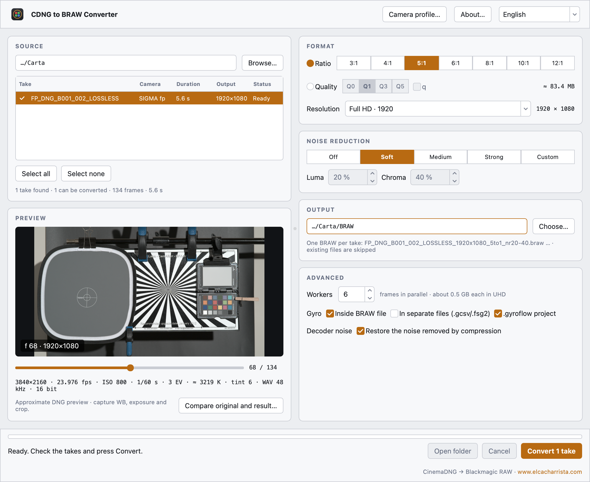

# cdng2braw

Converts CinemaDNG sequences into Blackmagic RAW files that open in DaVinci
Resolve like a clip from a Blackmagic camera, three to twelve times smaller than
uncompressed CinemaDNG.

Blackmagic publishes an SDK that reads `.braw` but none that writes it, so the
format was worked out from clips recorded in both formats and from what the SDK
decodes back; the article linked below explains how, and
[docs/format.md](docs/format.md) sums up the format as we understand it.

It is made for the **Sigma fp**: its takes come out with the colour of a
Blackmagic Video Assist recording, and white balance, ISO and exposure stay
adjustable in Resolve. The original **Blackmagic Pocket Cinema Camera** (2013)
works the same way through an experimental camera profile, described below. The
CinemaDNG of **other cameras** converts too, through a generic route that
develops the colour with the DNG's own matrices and fixes the white balance it
was shot with; in Resolve it can still be corrected, but not set from scratch
as with a raw clip. That route has not been tested with other cameras yet.



What it does:

- **Compression** at a target ratio, 3:1 to 12:1, or at a constant quality,
  Q0, Q1, Q3 or Q5 like the Blackmagic cameras, or, ticking *q*, any quantiser
  from 0 to 24.
- **Resolution**: the original, or a narrower width (3K, Full HD…) keeping the
  aspect ratio of each take, open gate included.
- **Noise reduction** before encoding, with three presets and a custom setting:
  a cleaner image leaves more of the file for detail.
- **Audio**: the take's WAV goes inside the BRAW.
- **Gyro data** from the Gyro2 module of
  [fpSup](https://github.com/ijigen/fpSup) is written into the BRAW as motion
  tracks, as a Blackmagic camera does, with a Gyroflow project that carries a
  lens profile computed from the distortion correction in the DNGs.
- **Batches**: one BRAW per take in a folder, with a preview of each.

The Blackmagic RAW SDK has no profile for the original Pocket Cinema Camera,
which recorded its raw as CinemaDNG before BRAW existed, so the app installs an
experimental one of its own on request. Every computer that opens those BRAW files needs it too. It is
calibrated against the DNG as Resolve develops it without colour management,
and the BRAW opens in P3-D65 linear, where the two match, white balance
included. Resolve's default for the DNG, "Blackmagic Design", uses the first
generation of Blackmagic Design Film, which the BRAW decoder does not have. For
that look, the app installs with the profile a LUT measured on Resolve's own DNG
decoder: decode the BRAW in DaVinci Wide Gamut / DaVinci Intermediate and apply
"Pocket 2013 DNG Film from DWG Intermediate", in the LUT list under cdng2braw.
A second LUT, "Sigma fp to Pocket 2013 DNG Film from DWG Intermediate", gives
Sigma fp takes the same look, decoded the same way; it was fitted on a scene
shot with both cameras under the same light.

## Using it

1. Choose a folder (or drop it on the window): every take inside, each in its
   own folder of DNG frames, appears in the list with its camera.
2. Pick the compression, the resolution and the noise reduction, and an output
   folder. One BRAW is written per take; existing ones are skipped.
3. Press **Convert**.

Takes from the original Pocket Cinema Camera need its camera profile, installed
from **Camera profile…** in the window's header. It asks for an administrator
password on macOS and for administrator permission on Windows, and every
computer that opens those BRAW files needs it too, with Resolve restarted after
installing it. The profile also installs the two LUTs in Resolve's LUT list,
under `cdng2braw`.

A Pocket take keeps its full highlight range: the BRAW carries the ISO it was
shot at (200, 400, 800 or 1600, read from the DNG) and Resolve applies it when it
opens the clip, with Exposure at 0. Resolve shows no ISO selector for cameras
supported through a Camera Support profile, so the ISO cannot be changed there;
use Exposure instead. Takes whose DNGs declare an exposure outside those four
ISOs are refused rather than guessed. See
[docs/pocket-og-exposure.md](docs/pocket-og-exposure.md).

In Resolve, a Pocket take opens in P3-D65 linear, where it matches its DNG. For
the DNG's default look, set Camera RAW to DaVinci Wide Gamut / DaVinci
Intermediate and apply "Pocket 2013 DNG Film from DWG Intermediate". To give a
Sigma fp take the same look, decode it the same way and apply "Sigma fp to
Pocket 2013 DNG Film from DWG Intermediate"; on the scene it was fitted on, the
Sigma fp needed about 6200 K and tint 0 to match the Pocket at its As Shot white
balance.

## Image fidelity benchmark

For measuring the Pocket OG pipeline against Resolve's CinemaDNG OpenEXR
exports (and regressions between builds) without opening Resolve each time:

```bash
make venv && make worker && make brawdec
make benchmark DATASET=~/Desktop/BMD SERIES=A
```

See [docs/image-fidelity-benchmark.md](docs/image-fidelity-benchmark.md). The
CinemaDNG dataset and EXRs stay outside Git (`~/Desktop/BMD`, `~/Desktop/EXR`).

## Getting it

There is a macOS app (Apple Silicon, macOS 26 or later) and a portable Windows
x64 ZIP (unzip it anywhere and run `cdng2braw.exe`) on the
[releases page](https://github.com/jahurtado/cdng2braw/releases). Both carry
the conversion engine inside, so there is nothing else to install. To open the
BRAW files you need DaVinci Resolve or any other application built on the
Blackmagic RAW SDK.

Neither is signed with a paid developer certificate, so the first launch is
blocked once and you allow it on purpose: on macOS through System Settings →
Privacy & Security, on Windows by clicking past the SmartScreen warning.

## From source

The engine and the app are C++17 with CMake. The app uses Qt 5 or 6; the
engine uses LibRaw and simdjson.

On macOS with [Homebrew](https://brew.sh/):

```sh
brew install cmake qt@5 libraw simdjson little-cms2 jpeg-turbo libomp
git clone https://github.com/jahurtado/cdng2braw.git
cd cdng2braw
make            # engine and app, in build/
make test       # the engine and app test suites
make package    # the redistributable app, in out/cdng2braw/
```

The packaging scripts and the app tests need Python 3.9 or later, with nothing
beyond the standard library; the one that comes with macOS will do.

On Windows, with MSVC 2022, Qt 6 and [vcpkg](https://vcpkg.io/), `build.ps1`
does the same: `.\build.ps1 app`, `.\build.ps1 test`, `.\build.ps1 package`.
The paths it expects are at the top of the script.

The app can be driven from outside for end-to-end tests:
[docs/automation.md](docs/automation.md).

## How it works

Each CinemaDNG frame is a Bayer mosaic. A BRAW frame is a *partial demosaic*:
a luma plane at full resolution and two colour-difference planes at half
resolution, each cut into 8 × 8 blocks, transformed with a DCT, quantised and
Huffman-coded. The engine develops each DNG with LibRaw only as far as it
needs to, builds those three planes the way the Blackmagic decoder expects to
find them, picks the quantiser that fits the requested size, and writes the
QuickTime container with the metadata Resolve reads.

The colour is calibrated against Blackmagic's own route for the Sigma fp, the
Blackmagic Video Assist recording it over HDMI, so a converted take behaves in
Resolve like one recorded on the Video Assist.

The full story, with the measurements and the comparisons, is in
[the article on elcacharrista.com](https://www.elcacharrista.com/en/articles/cinemadng-to-braw-converter-with-ai/).

The comments in the source are in Spanish, and some of them name the Python
prototype each part was ported from, which is not part of this repository.

## Licence

GPL-3.0-or-later; the full text is in [LICENSE](LICENSE). What the packages
carry inside them, and where its source is, is in
[app/THIRD_PARTY_NOTICES.md](app/THIRD_PARTY_NOTICES.md).

Blackmagic RAW, DaVinci Resolve and Blackmagic Video Assist are trademarks of
Blackmagic Design; SIGMA and fp are trademarks of SIGMA Corporation. This
project is not affiliated with or endorsed by either company.
