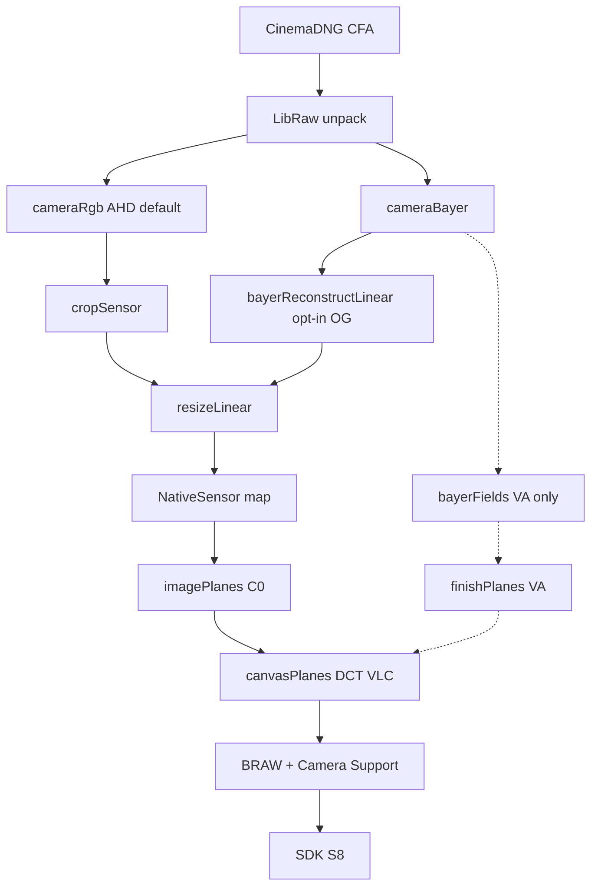

# EXP-005c — Pocket OG Bayer-native Architecture Feasibility

**Rama:** `experiment/pocket-og-bayer-native-feasibility`  
**Base:** `main` @ `62986b7` (PR #11 EXP-005b **mergeada**). Este trabajo **no** fusiona PRs.  
**Default:** RGB/AHD C0. `CDNG_OG_BAYER` es opt-in Pocket OG.  
**Alcance:** auditoría + viabilidad mínima. **No** EXP-006/007/008. **No** codec nuevo. **No** cambio de SDK.

Resumen: `benchmark/experiments/exp005c-results-summary.json`. Visuales → `out/`.

---

## Decisión

**Clase C.** La ruta mosaico→RGB lineal→NativeSensor es viable (SDK, exposición, geometría) pero no mejora sustancialmente BUG-002 frente a C0 AHD en las ROI medidas.

No se declara que el procesamiento parcial propietario de Blackmagic sea este prototipo.

BUG-002 sigue P0.

---

## A — Dos rutas (código real)

VA: códigos por fotosito, Y=(R+2G+B)/4 y croma como proporciones en dominio de señal. OG: curva por canal sobre RGB completo y mezcla 3×3 a YCbCr. No son la misma representación interna.

### Pocket OG / NativeSensor RGB

- Entrada: DNG Bayer (a menudo comprimido). LibRaw `unpack` + `dcraw_process` AHD.
- Normalización: negro racional restado tras 16-bit; highlight **clip**.
- Patrón: no entra en el encode salvo artefactos AHD (S1).
- Crop: DefaultCrop **después** del demosaic.
- Mapa: curva por canal + `inv(code_from_ycc)` → Y/Cb/Cr mezclados.
- `channelCodec() == nullptr` → `develop()` **no** llama a `bayerPlanes`.
- ISO: `gain=1`; `post_gain` en el perfil al decodificar.

### Video Assist / channelCodec Bayer

- Entrada: `cameraBayer()` (DefaultCrop en mosaico, dimensiones pares).
- Encode por fotosito: `k0 + s√(x·full·gain_ch)` (toe opcional).
- Y: blur 3×3 de códigos. Croma: proporciones filtradas binomial 7 en sitios 4:2:0.
- `finishPlanes` convierte proporciones a códigos con `signal(Y)` y enfoca luma.
- DCT/metadata/SDK: mismos bloques de contenedor, **otro** perfil Camera Support.

Evitar AHD **no** basta por sí solo para eliminar halos: el subsample 4:2:0, la curva y el SDK siguen ahí.

---

## B — Mosaico Pocket OG

Auditoría DNG A04_f044: **ok**

{
  "compression": 7,
  "is_compressed": true,
  "cfa_pattern": [
    1,
    2,
    0,
    1
  ],
  "cfa_repeat": [
    2,
    2
  ],
  "black_level": [
    256
  ],
  "white_level": [
    51080
  ],
  "default_crop_origin": [
    16,
    16
  ],
  "default_crop_size": [
    1920,
    1080
  ],
  "active_area": null,
  "baseline_exposure": [
    3.1
  ],
  "image_width": 1952,
  "image_length": 1112
}

LibRaw puede leer el Bayer comprimido (`unpack` → `raw_image`). No se asume parcheo del mosaico.

Compatibilidad `channelCodec` VA: **no** (YCC semánticamente distinta). Adaptación razonable: reconstruir RGB lineal del mosaico y seguir NativeSensor.

---

## Inventario

**Reutilizable:**
- Dng::cameraBayer() — unpack LibRaw, DefaultCrop, black/white, CFA 2×2, muestras lineales
- LibRaw unpack de DNG comprimido (tag 259≠1) → raw_image
- ogExposure / Camera Support / metadata de clip OG
- imagePlanes + NativeSensor::map (YCC mezclado por matriz, C0)
- canvasPlanes / DCT / VLC / contenedor BRAW (comunes)
- decodedPlanes y brawdec SDK
- green cubic direccional de bayerFields, aplicado a muestras lineales (no a códigos VA)

**No reutilizar para YCC OG:**
- ChannelCodec VideoAssist (k0+s√x, gain_rgb, toe SDK)
- bayerFields ratios (B−Ĝ)/Ĝ y sitios Cb DR / Cr UL
- finishPlanes: sharpen luma 1.2 y conversión ratio→código con signal(Y)
- noiseResolution crop/2 (cuarteto = 1 píxel VA)
- perfil Camera Support SIGMA fp / analog_gain

**Riesgos:**
- Enchufar cameraBayer en bayerPlanes/finishPlanes escribiría YCC estilo VA en un BRAW con perfil OG.
- LibRaw AHD introduce zippering/halos; evitarlo no prueba que el SDK OG espere mosaico parcial.
- cameraBayer recorta en el mosaico (par); cameraRgb recorta tras demosaic — hay que no recortar dos veces.
- Interpolación bilinear/cúbica sigue siendo un demosaic: puede suavizar detalle y false color propio.
- DNG OG comprimido: unpack OK, no se parchea el mosaico in-place (EXP-005).
- Rango dinámico: highlight clip de LibRaw no aplica en cameraBayer; highlights pueden diferir.

---

## C — Prototipo mínimo

`CDNG_OG_BAYER=1` (opt-in, solo `Route::Og`). Mutuamente excluyente con `CDNG_OG_DEBAYER`.
Default ausente ≡ AHD. Identidad de caché: `OUTPUT_ENV`.
Reconstrucción: verde cúbico direccional (como VA, en lineal) + R/B bilinear. Luego NativeSensor + C0.
No se llama a `finishPlanes` VA. No se cambia el SDK ni el formato.

---

## D — Smoke

Campaña: **measured**. q=2, NR/síntesis/RDOQ OFF.

| frame | halo p99 C0 | halo p99 Bayer | red. p99 | ruler left p99 C0 | Bayer | PSNR |
|-------|-------------|---------------|----------|-------------------|-------|------|
| A04_f044 | 0.4368452327001663 | 0.48409434603417817 | -10.8 % | 0.5215701938546804 | 0.5308251729331714 | -0.9824521830970254 |
| A04_f049 | 0.20159939659071566 | 0.41389986755059893 | -105.3 % | 0.5211456087888002 | 0.5306970964564601 | 22.53869003134534 |
| A01_f052 | 0.023345093737620722 | 0.04768155947722743 | -104.2 % | 0.06415835566760629 | 0.06528110320851249 | 41.13676415245146 |

Comparación S9 EXR vs C0 AHD vs CDNG_OG_BAYER. No se elige por PSNR global.

No se elige ganador solo por PSNR global.

---

## E — Cierre

Clase **C**. La ruta mosaico→RGB lineal→NativeSensor es viable (SDK, exposición, geometría) pero no mejora sustancialmente BUG-002 frente a C0 AHD en las ROI medidas.

Si A/B: siguiente paso acotado sería afinar interpolación de G/R/B **sin** AHD y **sin** VA finishPlanes, con los mismos ROI. No iniciado más allá del prototipo.

BUG-002 sigue P0. Defaults intactos.

