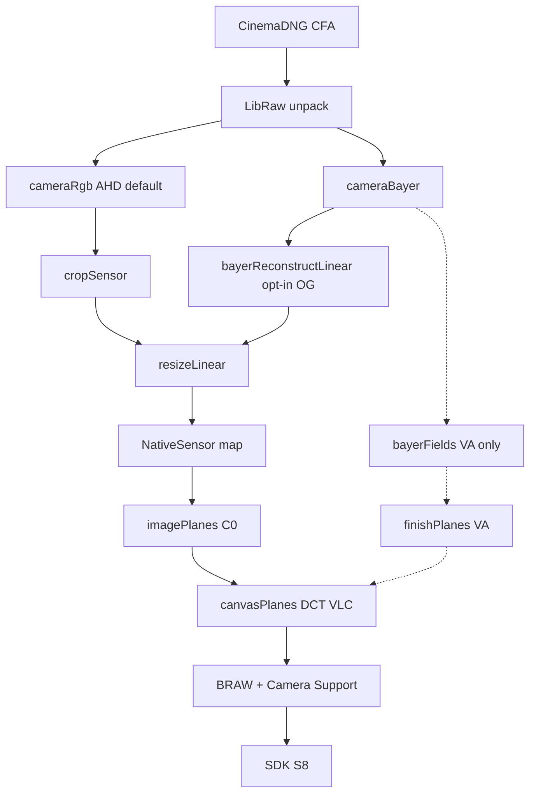

# EXP-005c — Pocket OG Bayer-native Architecture Feasibility

**Rama:** `experiment/pocket-og-bayer-native-feasibility`  
**Base:** `main` @ `62986b7` (PR #11 EXP-005b **mergeada**). Este trabajo **no** fusiona PRs.  
**Default:** RGB/AHD C0. `CDNG_OG_BAYER` es opt-in Pocket OG.  
**Alcance:** auditoría + viabilidad mínima. **No** EXP-006/007/008. **No** codec nuevo. **No** cambio de SDK.

Resumen: `benchmark/experiments/exp005c-results-summary.json`. Visuales → `out/`.

---

## Decisión

**Clase C.** La ruta mosaico→RGB lineal→NativeSensor es viable (SDK, exposición, geometría) pero no mejora sustancialmente BUG-002 frente a C0 AHD en las ROI medidas.

No se declara que el procesamiento parcial propietario de Blackmagic sea este prototipo.

BUG-002 sigue P0.

---

## A — Dos rutas (código real)



VA: códigos por fotosito, Y=(R+2G+B)/4 y croma como proporciones en dominio de señal. OG: curva por canal sobre RGB completo y mezcla 3×3 a YCbCr. No son la misma representación interna.

### Pocket OG / NativeSensor RGB

- Entrada: DNG Bayer (a menudo comprimido). LibRaw `unpack` + `dcraw_process` AHD.
- Normalización: negro racional restado tras 16-bit; highlight **clip**.
- Patrón: no entra en el encode salvo artefactos AHD (S1).
- Crop: DefaultCrop **después** del demosaic.
- Mapa: curva por canal + `inv(code_from_ycc)` → Y/Cb/Cr mezclados.
- `channelCodec() == nullptr` → `develop()` **no** llama a `bayerPlanes`.
- ISO: `gain=1`; `post_gain` en el perfil al decodificar.

### Video Assist / channelCodec Bayer

- Entrada: `cameraBayer()` (DefaultCrop en mosaico, dimensiones pares).
- Encode por fotosito: `k0 + s√(x·full·gain_ch)` (toe opcional).
- Y: blur 3×3 de códigos. Croma: proporciones filtradas binomial 7 en sitios 4:2:0.
- `finishPlanes` convierte proporciones a códigos con `signal(Y)` y enfoca luma.
- DCT/metadata/SDK: mismos bloques de contenedor, **otro** perfil Camera Support.

Evitar AHD **no** basta por sí solo para eliminar halos: el subsample 4:2:0, la curva y el SDK siguen ahí.

---

## B — Mosaico Pocket OG

Auditoría DNG A04_f044: **ok**

{
  "compression": 7,
  "is_compressed": true,
  "cfa_pattern": [
    1,
    2,
    0,
    1
  ],
  "cfa_repeat": [
    2,
    2
  ],
  "black_level": [
    256
  ],
  "white_level": [
    51080
  ],
  "default_crop_origin": [
    16,
    16
  ],
  "default_crop_size": [
    1920,
    1080
  ],
  "active_area": null,
  "baseline_exposure": [
    3.1
  ],
  "image_width": 1952,
  "image_length": 1112
}

LibRaw puede leer el Bayer comprimido (`unpack` → `raw_image`). No se asume parcheo del mosaico.

Compatibilidad `channelCodec` VA: **no** (YCC semánticamente distinta). Adaptación razonable: reconstruir RGB lineal del mosaico y seguir NativeSensor.

---

## Inventario

**Reutilizable:**
- Dng::cameraBayer() — unpack LibRaw, DefaultCrop, black/white, CFA 2×2, muestras lineales
- LibRaw unpack de DNG comprimido (tag 259≠1) → raw_image
- ogExposure / Camera Support / metadata de clip OG
- imagePlanes + NativeSensor::map (YCC mezclado por matriz, C0)
- canvasPlanes / DCT / VLC / contenedor BRAW (comunes)
- decodedPlanes y brawdec SDK
- green cubic direccional de bayerFields, aplicado a muestras lineales (no a códigos VA)

**No reutilizar para YCC OG:**
- ChannelCodec VideoAssist (k0+s√x, gain_rgb, toe SDK)
- bayerFields ratios (B−Ĝ)/Ĝ y sitios Cb DR / Cr UL
- finishPlanes: sharpen luma 1.2 y conversión ratio→código con signal(Y)
- noiseResolution crop/2 (cuarteto = 1 píxel VA)
- perfil Camera Support SIGMA fp / analog_gain

**Riesgos:**
- Enchufar cameraBayer en bayerPlanes/finishPlanes escribiría YCC estilo VA en un BRAW con perfil OG.
- LibRaw AHD introduce zippering/halos; evitarlo no prueba que el SDK OG espere mosaico parcial.
- cameraBayer recorta en el mosaico (par); cameraRgb recorta tras demosaic — hay que no recortar dos veces.
- Interpolación bilinear/cúbica sigue siendo un demosaic: puede suavizar detalle y false color propio.
- DNG OG comprimido: unpack OK, no se parchea el mosaico in-place (EXP-005).
- Rango dinámico: highlight clip de LibRaw no aplica en cameraBayer; highlights pueden diferir.

---

## C — Prototipo mínimo

`CDNG_OG_BAYER=1` (opt-in, solo `Route::Og`). Mutuamente excluyente con `CDNG_OG_DEBAYER`.
Default ausente ≡ AHD. Identidad de caché: `OUTPUT_ENV`.
Reconstrucción: verde cúbico direccional (como VA, en lineal) + R/B bilinear. Luego NativeSensor + C0.
No se llama a `finishPlanes` VA. No se cambia el SDK ni el formato.

---

## D — Smoke

Campaña: **measured**. q=2, NR/síntesis/RDOQ OFF.

| frame | halo p99 C0 | Bayer | red. | ruler C0 | Bayer | PSNR raw | PSNR matched | raw válido |
|-------|-------------|-------|------|----------|-------|----------|--------------|------------|
| A04_f044 | 0.4368452327001663 | 0.48409434603417817 | -10.8 % | 0.5215701938546804 | 0.5308251729331714 | -0.9824521830970254 | 22.550582609139514 | False |
| A04_f049 | 0.20159939659071566 | 0.41389986755059893 | -105.3 % | 0.5211456087888002 | 0.5306970964564601 | 22.53869003134534 | 22.534336687882792 | True |
| A01_f052 | 0.023345093737620722 | 0.04768155947722743 | -104.2 % | 0.06415835566760629 | 0.06528110320851249 | 41.13676415245146 | 41.13240356636423 | True |

PSNR raw vs S9 EXR; PSNR exposure-matched iguala luma media. A04_f044 EXR MINUS3: raw inválido. Halos C0 vs Bayer no dependen de ese PSNR. No se elige por PSNR global. Sin re-encode.

F: split raw / exposure-matched from cached f32; no full campaign

No se elige ganador solo por PSNR global.

---

## E — Cierre del prototipo mosaico→RGB

Clase **C**. La ruta mosaico→RGB lineal→NativeSensor es viable (SDK, exposición, geometría) pero no mejora sustancialmente BUG-002 frente a C0 AHD en las ROI medidas.

No se desarrollan más algoritmos de demosaic. BUG-002 sigue P0. Defaults intactos.

---

## F — Corrección del benchmark

A04_f044 usa `DNG1600MINUS3_00086731.exr` (**−3 EV**). C0 y Bayer tienen luma ~8× el EXR (`s9_exposure_rel` ≈ 7 ⇒ +3 EV). El PSNR raw **−0.98 dB** (Bayer) / **−1.03 dB** (C0) es una comparación inválida, no un fallo de exposición de la ruta Bayer (`luma_bayer_over_c0` ≈ 1).

A04_f049 / A01_f052 usan EXR de exposición nominal. PSNR raw **22.54 dB** (f049) y **41.14 dB** (f052) son comparaciones de dominio válido; Bayer queda ~2 dB por debajo de C0, coherente con interpolación más simple.

Métricas separadas: `psnr_raw` vs S9 tal cual; `psnr_exposure_matched` escala el EXR a la luma del candidato. No se reejecutó la campaña de encode.

---

## G — Representación cromática

Hasta el bitstream, **mismo álgebra YCC** (`code_from_ycc`):

```
Y  = (R + 2G + B) / 4
Cb = (B − G) / 2
Cr = (R − G) / 2
```

sobre **códigos de curva**, no BT.601. NativeSensor aplica eso **después** de RGB completo. ChannelCodec VA estima **proporciones** en `signal(code)=code−vertex` (∝ √lineal) y `finishPlanes` las convierte otra vez a Cb/Cr absolutos.

**NativeSensor:**
- RGB lineal (AHD o reconstruct)
- opcional rcm_tone
- por canal: curve.encode(c·scale) − offset  → códigos absolutos R,G,B
- YCC = inv(code_from_ycc)·códigos  (= Y=(R+2G+B)/4, Cb=(B−G)/2, Cr=(R−G)/2)
- imagePlanes C0: Y full; Cb/Cr = map(media 2×2 RGB lineal)
- finishPlanes: NR opcional; **no** convierte proporciones (channelCodec=null)
- canvasPlanes → DCT → VLC → bitstream Y/Cb/Cr en códigos
- SDK: inv_sqrt del perfil + CSC (matrices D65, r_gain/b_gain, ISO post_gain)

**ChannelCodec VA:**
- muestra lineal por fotosito × gain_ch × full
- encode: k0 + s√x (toe SDK bajo la rodilla)
- signal(code) = code − vertex  ∝ √(lineal)  (arriba de la rodilla)
- Y = blur 3×3 de códigos de fotosito (no RGB completo)
- Ĝ en R/B: cúbico direccional en lineal, luego encode verde
- proporción: (signal(Ch)−signal(Ĝ)) / max(signal(Ĝ), 1)  filtrada binomial 7 en sitios 4:2:0
- sitios: Cr UL (site 0), Cb DR (site 1) del cuarteto — asume fase tipo RGGB
- finishPlanes: sharpen Y 1.2; Cb = ρb·signal(Y_DR) / (2(1+(ρb+ρr)/4)); igual Cr con Y_UL
- bitstream: mismos códigos Y/Cb/Cr absolutos (ya no hay proporciones)
- SDK Sigma: perfil Camera Support fp + analog_gain del clip

Si B_lin = c_b·I y G_lin = c_g·I, signal_VA ∝ √I ⇒ signal_B/signal_G = √(c_b/c_g) independiente de I. Las proporciones sobreviven a un borde de intensidad. Cb absoluto (B−G)/2 en dominio de curva **no** es invariante con I (la curva no es lineal). C0 OG promedia RGB lineal 2×2 y luego aplica la curva: mezcla espacial antes de la no linealidad.

El binomial 7 sobre numerador/denominador de la proporción atenúa el zippering CFA antes del 4:2:0. NativeSensor C0 no ve el mosaico: el patrón periódico de las reglas entra como RGB AHD (false color ya interpolado) y luego caja 2×2.

**¿Sobreviven a finishPlanes?** Sí, como **construcción** de códigos: finishPlanes reescribe ρ·signal(Y_local) → Cb/Cr absolutos, así el bitstream es el mismo álgebra YCC que NativeSensor. No sobreviven como campo de proporciones. DCT + cuantización Y y C independientes pueden romper ρ∝Y. El SDK no relee proporciones: solo códigos + inv_sqrt.

No se asume equivalencia con el demosaico parcial propietario de Blackmagic.

---

## H — Camera Support

tools/make_pocket_og_iso_profile.py deriva ISO desde la revisión calibrada; no toca inv_sqrt ni CSC.

Elementos que determinan el revelado:
- **signal_model:** model/*_cinemadng_signal.json (sensor_curve, code_from_ycc) + inv_sqrt del perfil (decode SDK)
- **channel_codec:** No está en el perfil. Solo SignalMap::channelCodec() en el encoder (VideoAssist).
- **response_curve:** perfil.modes[].inv_sqrt {A,B,X,Y,Z,y_knee,clampMax}; encode OG usa sensor_curve del JSON de señal
- **channel_gains:** VA: gain_rgb en video_assist_input_transform.json. OG: input_channel_scale + post_gain ISO
- **chroma_reconstruction:** SDK: code_from_ycc implícito + upsample opaco. Encoder VA: finishPlanes. Encoder OG: imagePlanes C0
- **matrices:** csc_params.table.d65_forward_matrix_by_temperature_and_tint
- **white_balance:** r_gain, b_gain × ejes temperature/tint; clip kelvin/tint en bmdf
- **iso_exposure:** iso_params.iso_gain_table pre_gain/post_gain; clip isoe/expo/agpf; analog_gain en moov
- **identity_revision:** cameras[].manufacturer + camera_model → camera_type; cameras[].revision → ctrn

Perfil OG ISO (lectura): `revision` 1128878927, `chroma_alignment` RGGB, `native_iso` 400, CSC keys ['b_gain', 'csc_temperature_axis', 'csc_tint_axis', 'd65_forward_matrix_by_temperature_and_tint', 'r_gain'], `inv_sqrt` ['A', 'B', 'X', 'Y', 'Z', 'clampMax', 'y_knee']. **No** hay campo ChannelCodec ni modo de proporciones.

finishPlanes ya escribe Cb/Cr como códigos absolutos. El perfil OG existente espera esos códigos + inv_sqrt. No hay flag de proporciones en Camera Support.

camera_type SIGMA fp + revisión fp haría que OpenClip cargue el perfil Sigma. Prohibido. La OG ya tiene identidad Blackmagic Pocket Cinema Camera / rev CISO.

No se modifican perfiles instalados ni defaults. No se implementa otra ruta experimental aquí.

---

## I — Decisión arquitectónica ChannelCodec OG

**Clasificación:** `potencialmente_viable_requiere_informacion`.

El prototipo mosaico→RGB→NativeSensor permanece **clase C**. ChannelCodec específico OG es **potencialmente viable** con las herramientas actuales (misma YCC tras finishPlanes, perfil OG ya legítimo), pero **falta información** para demostrarlo:

- Implementar ChannelCodec sobre SensorCurve OG (encode/signal) — no hecho; no en esta fase.
- Fase CFA Pocket OG es GBRG (CFA [G,B,R,G]); bayerFields sitúa Cb en DR y Cr en UL (fase RGGB). Desalineación no medida.
- chroma_alignment del perfil OG es RGGB; relación con el mosaico GBRG no demostrada para la ruta Bayer.
- Y 3×3 de fotositos ≠ Y NativeSensor de RGB demosaicado: colorimetría SDK vs DNG sin medir.
- noiseResolution usa crop/2 si channelCodec()!=nullptr: cambiaría grano del decoder si se activa NR/síntesis.
- Ventaja de proporciones tras DCT/cuantización y upsample SDK: no medida (BUG-002).

**Smoke mínimo:** no procede ahora (Falta ChannelCodec OG y mapeo CFA; no se implementa otra ruta experimental en esta fase.).

Opt-in solo OG, default AHD intacto. Frames: A04_f049 y A01_f052 (EXR de exposición nominal). A04_f044 solo con EXR×8 o matched. q=2 NR/RDOQ OFF. ROI white_strip, cc_ruler_*, bordes. Comparar CinemaDNG / C0 / codec-OG. Éxito: SDK + colorimetría + no empeorar exposición; BUG-002 se juzga en ROI, no PSNR global.

No EXP-006/007/008. No investigación de compresión. Sin merge.

BUG-002 sigue P0.

